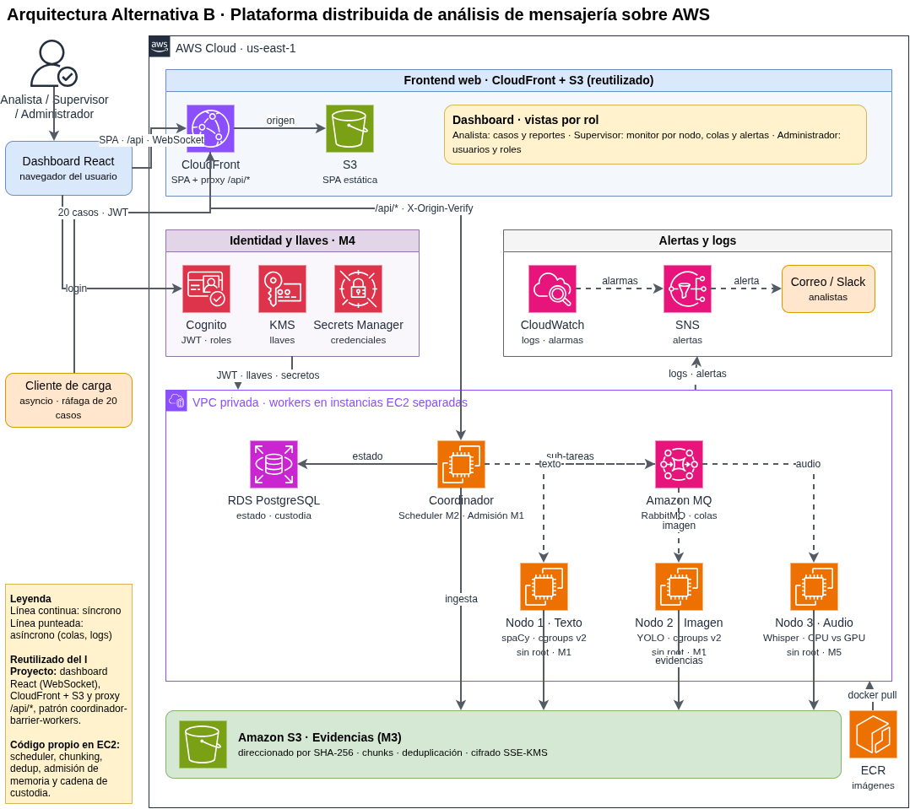

# Distributed messaging-analysis platform on AWS

II Programming Project (IC-6600 Operative Sistems Course): a distributed platform that analyzes messaging data (text, images and audio) on AWS. A coordinator splits each case into sub-tasks, and specialized workers process them in parallel. Each project module focuses on an operating-systems concern.

Full documentation lives in [docs/](docs/).

## Architecture


Solid lines are synchronous calls, dashed lines are asynchronous (queues, logs, alerts). The editable source, with the full detail, is [docs/architecture/diagram.drawio](docs/architecture/diagram.drawio) (its labels are still in Spanish).

Key points:

- **Frontend:** a React dashboard served from S3 through CloudFront, with views per role (analyst, supervisor, administrator).
- **API path:** CloudFront proxies `/api/*` to the coordinator and adds an `X-Origin-Verify` header that the coordinator must check.
- **Coordinator:** one EC2 instance in a public subnet. It runs memory admission (M1) and the scheduler (M2).
- **Workers:** one EC2 instance each for text, image and audio, in private subnets. They run without root and under cgroups v2.
- **State and messaging:** RDS PostgreSQL for state and the custody log, Amazon MQ (RabbitMQ) for sub-task queues.
- **Evidence:** S3 objects addressed by SHA-256, chunked, deduplicated and encrypted with KMS (M3).
- **Security:** Cognito issues JWTs with roles, Secrets Manager holds credentials (M4).
- **Alerts:** CloudWatch alarms publish to SNS, which sends email.
- **Management:** instances are reached through SSM only. No SSH, no key pairs.

## Modules

| Module | Topic | Report |
|---|---|---|
| M1 | Memory | [docs/module-m1-memory.md](docs/module-m1-memory.md) |
| M2 | Scheduling | [docs/module-m2-scheduling.md](docs/module-m2-scheduling.md) |
| M3 | I/O and storage | [docs/module-m3-io-storage.md](docs/module-m3-io-storage.md) |
| M4 | Security | [docs/module-m4-security.md](docs/module-m4-security.md) |
| M5 | Heterogeneous compute | [docs/module-m5-heterogeneous-compute.md](docs/module-m5-heterogeneous-compute.md) |

Who owns what: [docs/responsibilities.md](docs/responsibilities.md). What is reused from Project I: [docs/reuse.md](docs/reuse.md).

## Requirements

- Terraform >= 1.6 and AWS credentials with admin-like rights on the target account.
- AWS CLI and the Session Manager plugin, to reach instances.
- A confirmed email address for alerts and a globally unique Cognito domain prefix.

## Deploy

Terraform builds the infrastructure only. The application is pushed afterwards by deployment scripts that read `terraform output`.

```bash
cd infra/terraform/environments/dev
cp terraform.tfvars.example terraform.tfvars   # set alert_email and cognito_domain_prefix
terraform init
terraform plan
terraform apply
```

Then confirm the SNS subscription email. Details, cost estimate, GPU switch and destroy steps are in [infra/terraform/README.md](infra/terraform/README.md).

Dev costs roughly 280-300 USD/month if left running 24x7. Run `terraform destroy` or stop the workers between sessions.

## Repository map

| Path | Contents |
|---|---|
| `infra/terraform/` | Terraform modules and the `dev` environment (`prod` is a template only) |
| `infra/docker/`, `infra/monitoring/`, `infra/tls/` | Container, monitoring and TLS assets (not started) |
| `services/coordinator/` | API, admission, scheduler and state (not started) |
| `services/workers/` | Common code plus text, image and audio workers (not started) |
| `services/storage/`, `services/security/` | Chunking, content store, backpressure; auth, crypto, custody log (not started) |
| `services/load_client/`, `services/alerts/` | Burst load client and alerting (not started) |
| `frontend/` | React dashboard (not started) |
| `dataset/` | Test data, generators and ground truth |
| `experiments/` | Per-module measurements and fault tests |
| `scripts/` | Bootstrap, dataset, deploy and measurement scripts |
| `tests/` | Unit and integration tests |
| `docs/` | Module reports, architecture diagram, dataset, AI log, report |
