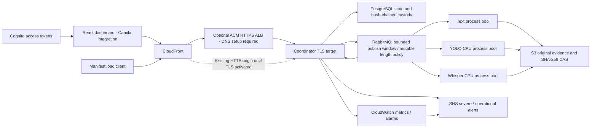

# Current architecture

Analysis runs in killable child processes under per-node Docker cgroup limits.
RDS uses TLS; MQ uses AMQPS; S3 uses HTTPS and SSE-KMS. TLS-origin activation
uses a publicly validated certificate at the ALB and encryption to a self-signed
coordinator target; ALB does not authenticate that target certificate. Security
groups restrict the target hop and the origin header is checked at the app.
Cloud activation and measurements remain separate from implementation status.
