INSTITUTO TECNOLÓGICO DE COSTA RICA

Escuela de Ingeniería en Computación

IC-6600 Principios de Sistemas Operativos

**II Proyecto Programado — Alternativa B**

Plataforma distribuida de análisis de datos de mensajería

INFORME FINAL

Integrantes (carné sin confirmar — `[FALTA: carné]` para los tres):

- Fabián Ricardo Vargas Araya
- Camila de Jesús Hidalgo Mora
- David Molina Guerrero

Grupo 50

Profesor: Jorge `[FALTA: apellido del profesor]`

II Semestre, 2026 — 12 de noviembre de 2026

```{=openxml}
<w:p><w:r><w:br w:type="page"/></w:r></w:p>
```

## Resumen

Este informe documenta la segunda entrega del proyecto programado del curso (Alternativa B): una plataforma distribuida que recibe exportaciones de chat (WhatsApp/Telegram), imágenes y notas de voz, las reparte entre workers especializados por tipo de contenido y produce un reporte consolidado de hallazgos por caso. El sistema reemplaza la pila de Proyecto I (SQS + DynamoDB, un solo proceso coordinador) por RabbitMQ (pika) y PostgreSQL (psycopg 3, SQL plano), con S3/MinIO como almacén de bytes; el detalle de qué se reutiliza, modifica o agrega está en `docs/reutilizacion.md`.

Los cinco módulos de sistemas operativos exigidos por el enunciado están implementados en código y tienen evidencia medida local: M1 (admisión de memoria con cgroups v2, huella RSS/PSS por modelo, reproducción de OOM), M2 (planificación FIFO/aging con cuatro niveles de prioridad), M3 (transferencia por chunks con verificación de hash, almacenamiento direccionado por contenido SHA-256, deduplicación y cola acotada con contrapresión), M4 (autenticación JWT de Cognito con tres roles, bitácora de custodia encadenada por hash, TLS en tránsito, cifrado en reposo con KMS) y M5 (comparación de hilos y cuantización de CPU para YOLOv8n y faster-whisper, sin GPU disponible). Ninguna ficha de módulo cita una referencia bibliográfica (autor, capítulo); el repositorio solo contiene enlaces a proyectos (Proyecto I, COCO, Ultralytics, faster-whisper), por lo que cada concepto de sistemas operativos se marca `[FALTA: referencia]` en la sección correspondiente.

El dataset cumple los mínimos de la sección B.3 según los manifiestos versionados: 40 casos, 21 337 mensajes de texto (21 000 de usuario más 337 de sistema, contados por parseo directo de los chats), y 300 imágenes, 150 audios y 15 videos **declarados** por los manifiestos (la media no está en disco ni en git). La evaluación automática sobre las 505 fuentes etiquetadas alcanza precisión/recall de 0.884/0.688 en `threat` y cae a 0.697/0.172 en `sensitive_image` a nivel de hallazgo (0.964/0.370 a nivel de imagen).

La limitación más importante de esta entrega es que **ninguno de los cinco escenarios de la sección B.6 tiene evidencia en la nube**: los cinco se ejecutaron en local o en Docker/WSL2, y tres de los cinco (caída de worker, reinicio del coordinador, cancelación en curso) solo dejaron un veredicto `OK` transcrito de consola, sin métricas ni gráficos guardados. El capítulo 8 detalla esta y las demás limitaciones; el capítulo 9 documenta los errores de IA corregidos durante el desarrollo.

```{=openxml}
<w:p><w:r><w:br w:type="page"/></w:r></w:p>
```

## 1. Introducción y alcance

El enunciado (Alternativa B) pide extender un sistema de Proyecto I hacia una plataforma de análisis de datos distribuidos que cubra cinco áreas de sistemas operativos (gestión de memoria, planificación, E/S y almacenamiento, protección y seguridad, cómputo heterogéneo), con evidencia medida por módulo y un conjunto de escenarios de carga y tolerancia a fallos.

El equipo adaptó el dominio de Proyecto I (conversión de medios con ffmpeg) hacia el análisis de contenido potencialmente sensible en conversaciones de mensajería: texto plano de chats exportados, imágenes adjuntas y notas de voz. El patrón de coordinación (caso → sub-tareas → barrera → reporte) se mantiene; lo que cambia es la tecnología de cola y persistencia (RabbitMQ + PostgreSQL en vez de SQS + DynamoDB), los workers de análisis (reglas de texto, YOLOv8n, faster-whisper en vez de ffmpeg) y los cinco módulos de sistemas operativos, que son nuevos frente a Proyecto I.

Alcance cubierto por esta entrega, verificado contra el código (no contra la documentación cuando ambas discrepan, según `docs/informe/inventario.md`):

- Pipeline funcional completo (recepción, cola/enrutado, workers, barrera, reintentos, cancelación, reporte, alertas, dashboard) corriendo end-to-end en local (`services/workers/scripts/local_e2e.py`) y desplegado una vez en AWS (dos casos reales documentados en `docs/handoff-completion.md`, sin archivo crudo).
- Los cinco módulos M1–M5 con código e instrumentación propios, cada uno con al menos una campaña de medición local o en Docker/WSL2.
- Un dataset sintético de 40 casos con ground truth y una evaluación automática de precisión/recall.
- Cinco escenarios de la sección B.6, todos con evidencia **local únicamente**.

Fuera de alcance o pendiente, para que quede explícito desde esta introducción: ejecución de los cinco escenarios B.6 en AWS, medición de M1–M5 en el hardware objetivo de despliegue (t3.large) salvo M4, GPU para M5, y la media del dataset (imágenes/audio/video) en disco. Estos puntos se retoman en el capítulo 8.

## 2. Arquitectura

La arquitectura de despliegue (Figura 1) es la que ya existía en `docs/architecture/ArchitectureAWS.jpg` y se reutiliza aquí sin cambios: CloudFront sirve el frontend desde S3 y expone `/api/*` hacia el coordinador en EC2 (subred pública, solo alcanzable desde CloudFront); el coordinador y los workers de texto/imagen/audio (subredes privadas, NAT) usan Amazon MQ (RabbitMQ), RDS PostgreSQL y un bucket S3 cifrado con KMS como almacén de evidencia. Hay que anotar que algunas etiquetas de ese diagrama no tienen respaldo en el código actual: "chunks AES-GCM" (no hay AES en el código), "FS solo lectura" en los workers (solo el compose del coordinador lo declara), "Correo / Slack" (solo existe una suscripción de correo SNS) y "S3 evidencias chunks por SHA-256" (los objetos son archivos completos bajo `content/<sha256>`, no chunks).

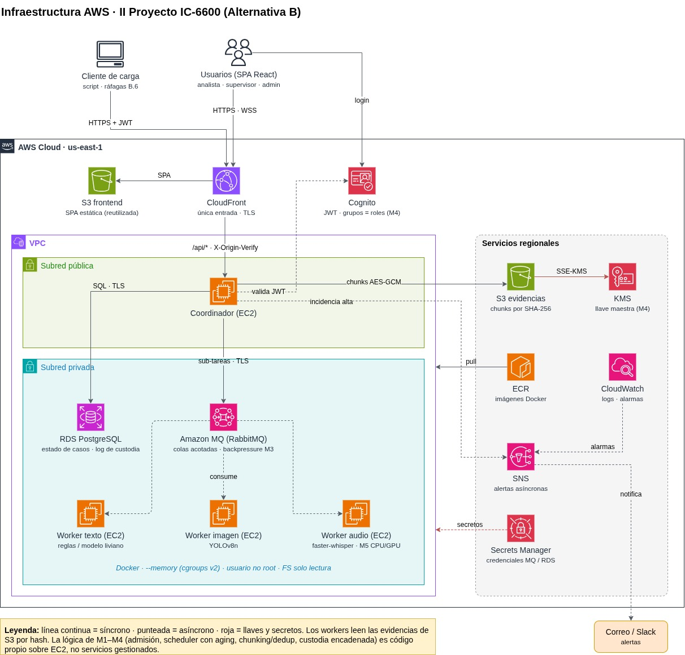{width=6in}

No existía en el repositorio ni un diagrama de componentes independiente del Mermaid de alto nivel (`docs/architecture/current.md`) ni un diagrama del flujo de un caso (solo prosa en `services/coordinator/README.md:114-155`); las Figuras 2 y 3 se generaron para este informe a partir del código, como lo indican sus propios pies.

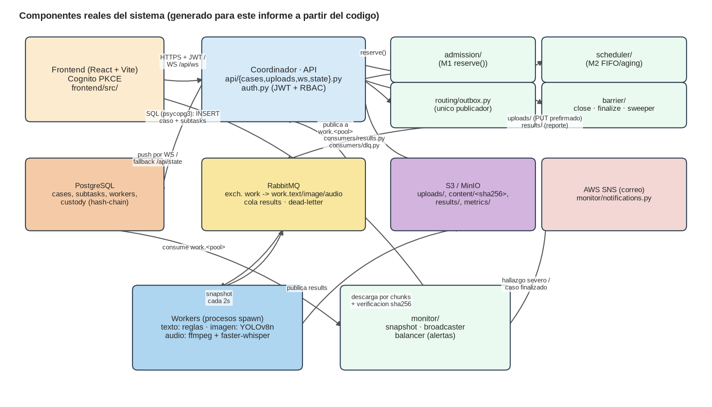{width=6in}

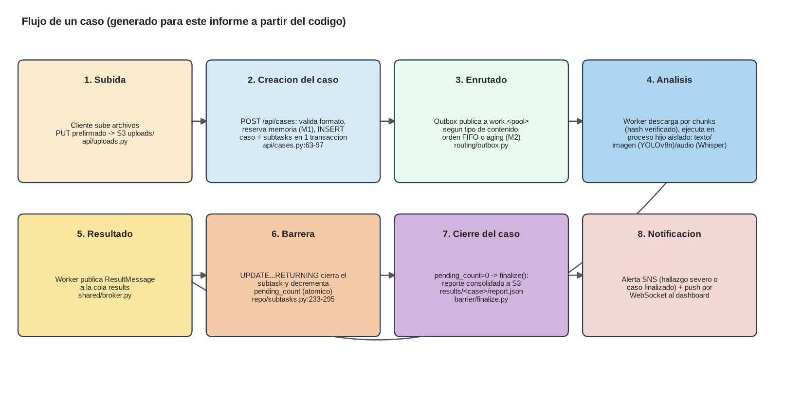{width=6in}

Resumen de qué se reutilizó, modificó o agregó respecto a Proyecto I (detalle completo en `docs/reutilizacion.md`):

| Categoría | Contenido |
|---|---|
| Reutilizado casi sin cambios | Contratos compartidos, broadcaster/snapshot por WebSocket, salud y logging, hooks y componentes del dashboard, middleware de verificación de origen, entrega CloudFront + S3 del frontend, herramientas de prueba local, acceso por SSM |
| Reutilizado y modificado | API, planificador de casos, barrera, sweeper, consumidores, repositorios, constructor de reportes, reglas de alertas, runner de workers, vistas del dashboard, manifiesto y script de subida del dataset, módulos de Terraform, despliegue |
| Nuevo | M1 a M5, workers de análisis, planificador por prioridades, almacén direccionado por contenido, autenticación de usuarios, bitácora de custodia, contenido del dataset, cliente de carga, pruebas de tolerancia a fallos |

El cambio de SQS/DynamoDB a RabbitMQ/PostgreSQL se justifica por tres necesidades que Proyecto I no cubría: colas acotadas con rechazo al publicador para la contrapresión de M3 (SQS no tiene longitud máxima de cola), colas con prioridad nativa para M2, y operaciones atómicas multi-fila (la barrera y el outbox pasan a ser transacciones SQL simples en vez de `TransactWriteItems`).

## 3. Dataset

El dataset es sintético: texto por plantillas (`generate_dataset.py` + `corpus.py`, semilla 42), imágenes de COCO 2017 val (licencias CC BY/CC BY-SA/CC BY-ND, "sin restricciones conocidas"; 167/84/48/1 de las 300 usadas según los manifiestos), audio por TTS (Windows SAPI David/Zira en inglés, o espeak-ng en Linux) y video por `ffmpeg testsrc2`/`noise` con la pista de audio TTS. La media (imágenes, audios, videos) está excluida de git (`dataset/.gitignore`) y no se verificó en disco; las cifras de la tabla siguiente son **declaradas por los manifiestos**, no confirmadas contra archivos reales, salvo el conteo de texto.

| Mínimo B.3 | Valor real | Veredicto |
|---|---|---|
| 40 casos | 40 (`dataset/cases/*/manifest.json`) | cumple |
| ≥10 casos heterogéneos | 15 (10 con video pequeño + 5 pesados) | cumple |
| 20 000 mensajes de texto | 21 337 (21 000 de usuario + 337 de sistema, contados por parseo directo de los chats versionados) | cumple, verificado |
| 300 imágenes con proporción positiva conocida | 300 declaradas; 73 positivas / 227 negativas (≈24.3 %), positivas = solo cuchillo/tijeras de COCO | cumple, declarado |
| 150 audios de distinta duración | 150 declarados, 3.8–172.3 s, suma 73.9 min | cumple, declarado |
| ≥5 casos ≥200 MB | 5 videos: 362 217 118 / 408 513 738 / 343 374 671 / 264 284 958 / 269 614 277 B (casos 011–015) | cumple, declarado |
| Ground truth | 40 archivos, 505 fuentes etiquetadas | cumple |
| Procedencia y licencias | Declaradas por fuente en `docs/dataset.md:280-287` | cumple |

Total declarado: 505 fuentes (40 texto, 300 imagen, 150 audio, 15 video), ≈1.7 GB (1 715 067 965 B). Hay una diferencia menor de contabilidad entre los *bins* de duración de audio del manifiesto (73/56/21) y los de `docs/dataset.md:231` (74/55/21) que no se reconcilió por depender de la media ausente.

La evaluación automática (`dataset/evaluation/metrics.json`, ejecutada el 2026-11-11 sobre las 505 fuentes; la máquina de ejecución no quedó registrada) da, por categoría, precisión/recall/F1: `threat` 0.884/0.688/0.774, `offensive_language` 0.804/0.741/0.771, `violence` 0.657/0.657/0.657, `illicit_activity` 0.614/0.614/0.614, `sensitive_image` 0.697/0.172/0.275. A nivel de imagen (no de hallazgo), `sensitive_image` sube a precisión 0.964 / recall 0.370 (27 TP, 1 FP, 46 FN, 226 TN); el IoU medio de las cajas emparejadas es 0.845.

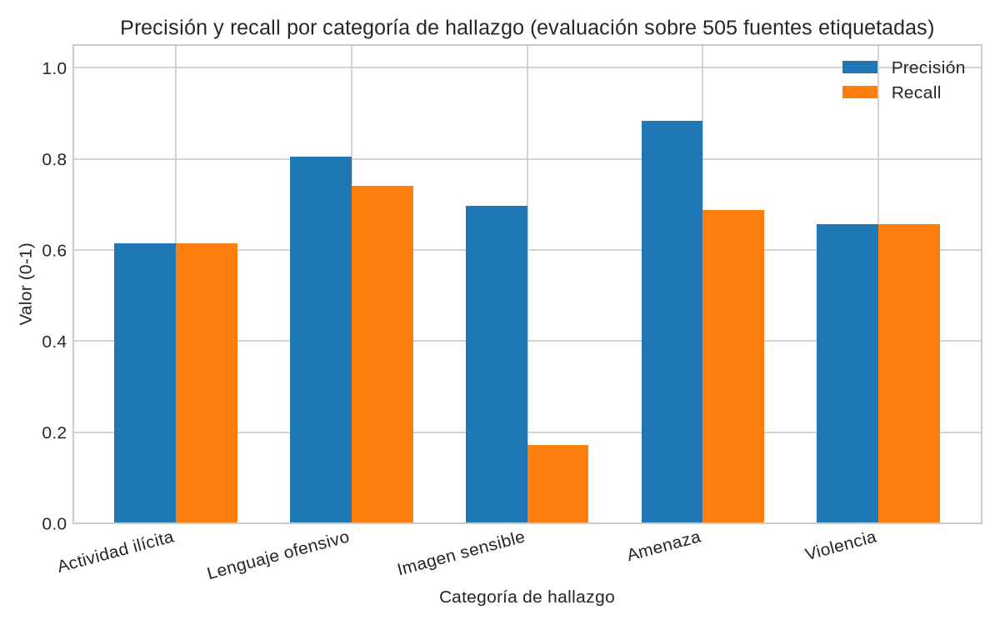{width=5in}

El recall bajo de `sensitive_image` es consistente con el diseño de la regla: YOLOv8n con `conf=0.25` solo produce el hallazgo `SENSITIVE_IMAGE` cuando detecta clases COCO `knife` o `scissors`, así que cualquier imagen positiva por otro criterio del ground truth que no dependa de esas dos clases queda como falso negativo por construcción, no por un error de medición.

Ética y licencias: las imágenes mantienen la licencia original de COCO por fuente (archivo de datos `dataset/generators/data/coco_selection.json`); el texto y el audio son sintéticos (plantillas y TTS), no provienen de conversaciones reales, lo que evita el uso de datos personales reales en el dataset de evaluación.

## 4. Pipeline funcional

Verificación contra el código de los requisitos funcionales de la sección B.4:

| Requisito | Veredicto | Mecanismo real |
|---|---|---|
| Recepción | cumple; "múltiples fuentes" parcial | `POST /api/uploads` (URL prefirmada) + `GET /api/dataset` + `POST /api/cases` (1 a 1000 archivos). Extensión desconocida nace `failed/unsupported_format`; el contenido se valida en el worker. `CaseSource` solo admite `manual` y `auto`. |
| Cola y enrutado | cumple | Un sub-task por archivo; operación → pool; publicación por el exchange `work` con clave = pool, limitada por `OUTBOX_QUEUE_LIMIT`, orden FIFO/aging decidido en SQL. |
| Workers texto/imagen/audio | cumple con límites | Reglas bilingües (texto, sin ML), YOLOv8n `conf=0.25` (imagen), ffmpeg + faster-whisper `tiny int8` (audio). Confianza de texto fija en 0.65. |
| Estados y barrera | cumple | Sub-task: pending/assigned/running/retrying/completed/failed/cancelled; caso: queued/processing/retrying/completed/partially_completed/failed/cancelled. Barrera: una sola sentencia `UPDATE ... RETURNING` que cierra el sub-task y decrementa `pending_count`; a cero, `finalize` idempotente. |
| Reintentos | cumple | `delay = min(60, 2 × 2^(intento-1))` segundos, máximo 3 intentos totales, sin jitter. Reintenta `internal`, `external_api_error`, `worker_lost`. |
| Cancelación real | cumple en el worker; sin purga del lado del coordinador | El worker revisa `cancel_requested` antes, durante (cada 0.25 s) y después de operar; mata hijos/descendientes y borra temporales. La descarga de S3 no se interrumpe; un sub-task en cola solo se cancela al ser consumido. |
| Reporte consolidado | cumple con límites | Hallazgos, categorías, línea temporal, grupos, sub-tasks, workers usados; evidencia con `source_key`, remitente, timestamp, recorte, bbox, sha256. Sin estructura de "incidencias" separada. |
| Alertas | cumple (solo correo), mejor esfuerzo | SNS en hallazgo HIGH/CRITICAL, caso finalizado, y alertas operativas (máx. cada 300 s por pool/nivel); no-op si falta `ALERTS_TOPIC_ARN`. |
| Dashboard | parcial: sin GPU | Snapshot cada 2 s, push por WebSocket; CPU de sistema, memoria de cgroup, colas, alertas; sin métrica de GPU en ninguna parte del código. |
| Recuperación tras reinicio | cumple | Estado en PostgreSQL; el outbox republica lo no encolado; el sweeper al arrancar finaliza casos con `pending_count=0`. Se pierde en memoria el deduplicado de alertas y el buffer de muestras. |
| Detección de caída de worker | cumple | Redelivery del broker sin ejecutar → `worker_lost`; heartbeat cada 5 s con sweeper cada 5 s, muerto si `last_seen` > 60 s. |

## 5. Módulos de sistemas operativos

Cada subsección cubre los cinco elementos pedidos por el enunciado: qué se implementó y dónde, el concepto de sistemas operativos que lo sustenta, el método de medición, los resultados y la interpretación. Ninguna de las cinco fichas (`docs/module-m1..m5-*.md`) cita una referencia bibliográfica con autor y capítulo —el repositorio solo tiene enlaces a proyectos (sección "Referencias")—, así que el elemento de concepto se marca `[FALTA: referencia]` en cada módulo.

### 5.1 M1 — Gestión de memoria (responsable: David Molina)

**Qué se implementó y dónde.** Admisión de memoria por caso dentro de la misma transacción que crea el caso (`admission/__init__.py:15`, llamado desde `api/cases.py:80`); límites de cgroup por contenedor (256 MiB para texto, 1 GiB para el resto, `remote-node.sh:123`); lectura de memoria de cgroup v2 (`workers/runner/memory.py:8-30`); aislamiento por proceso hijo `spawn` matable (`isolation.py:46-80`); un hijo que muere sin resultado se reporta como `WORKER_LOST` ("possible OOM") y es reintentable.

**Concepto de sistemas operativos.** Control de admisión y aislamiento de memoria por proceso (límites duros vs. reserva lógica, recuperación tras falta de memoria). `[FALTA: referencia]`.

**Método de medición.** Perfiles de RSS/PSS por pool nativos (Windows 11, CPython 3.13) y en Linux (WSL2, Docker local, commit `a7c7148`) variando el límite de cgroup (`limits.csv`, 21 corridas); comparación de huella propia vs. compartida por pool con `smaps_rollup`; ráfaga de 20 casos con modelos reales midiendo memoria por worker (`worker-memory.csv`, 483 filas).

**Resultados.**

| Pool | RSS cargado (nativo) | PSS propio / compartido (Linux, 2 GiB) |
|---|---|---|
| Texto | 34 926 592 B | 103.04 / 41.70 MiB |
| Imagen | 250 294 272 B | 676.81 / 296.26 MiB |
| Audio | 166 043 648 B | 466.92 / 191.94 MiB |

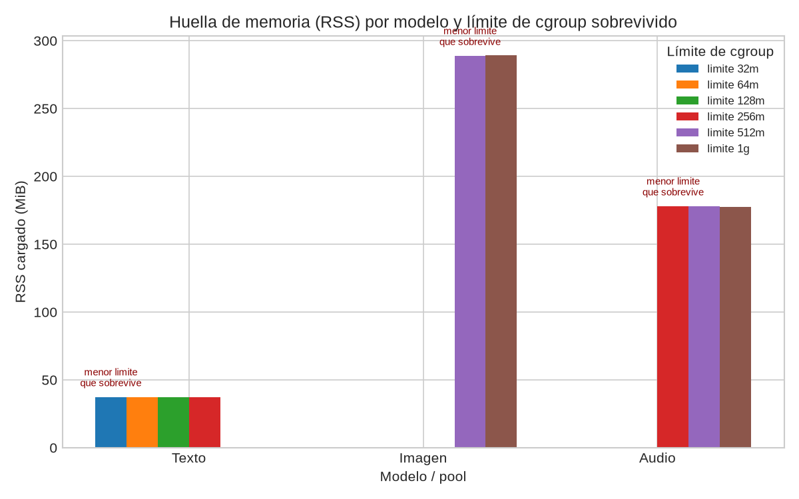{width=5.5in}

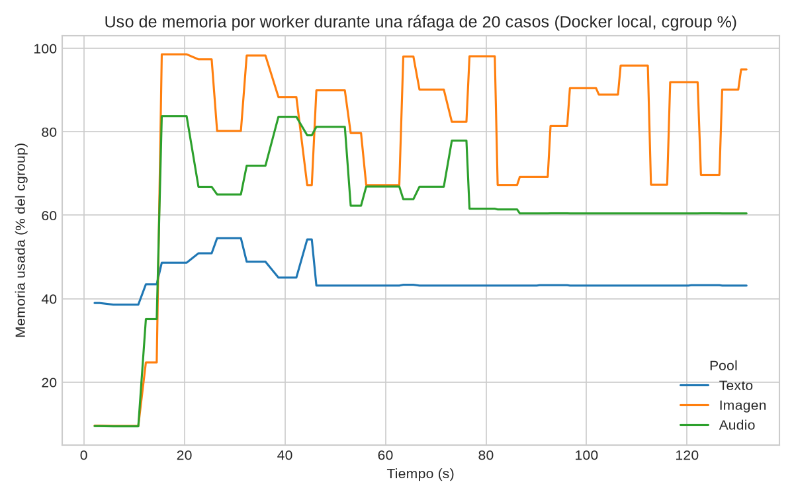{width=5.5in}

**Interpretación.** El pool de imagen (YOLOv8n) es el más pesado tanto en RSS nativo como en PSS propio, consistente con cargar pesos de un modelo de visión frente a reglas de texto sin modelo. La brecha entre PSS propio y compartido en los tres pools (p. ej. 676.81 vs. 296.26 MiB en imagen) indica que buena parte de la huella es memoria compartible entre procesos del mismo pool, pero el código actual **no la explota**: cada operación lanza un proceso `spawn` nuevo que recarga el modelo (decorador `@lru_cache` por proceso, inútil entre invocaciones separadas), así que en producción se paga el costo completo de PSS propio en cada sub-tarea, no el compartido. La comparación fork/copy-on-write solo existe como medición aislada (`measure.py:36-66`), no está integrada al pipeline. Las bases de admisión (512/384/64 MiB) son "estimaciones iniciales" sin calibrar contra estos perfiles medidos, lo que explica que inicialmente 37 de 40 casos del dataset fueran rechazados bajo un presupuesto de 3 GiB en la nube (corregido cobrando la base una sola vez por operación distinta en vez de por sub-tarea).

Evidencia B.5 — veredictos: tabla de huella por modelo **cumple**; gráfico de memoria por worker en ráfaga **parcial** (Docker local, no AWS, sin cifras citadas en la ficha); prueba de OOM provocado y recuperación **parcial** (OOM reproducido con éxito al reintentar con límite mayor, pero sin requeue real por el broker); comparación de memoria entre estrategias **cumple**; control de admisión a partir de datos medidos **parcial** (las bases no están calibradas contra los perfiles).

### 5.2 M2 — Planificación de cargas (responsable en matriz: Fabián Vargas)

**Qué se implementó y dónde.** Cuatro niveles de prioridad LOW/MEDIUM/HIGH/CRITICAL (`shared/analysis.py:67-76`, mapeados a prioridad AMQP 1–4 en `shared/routing.py:98-104`); aging por edad con `min(4, base + edad/30s)` y desempate por `created_at` (`scheduler/__init__.py`); selección ordenada en SQL (`repo/subtasks.py:115-138`); el outbox relay solo publica mientras la cola de destino tenga espacio (`outbox.py:99-127`). Política por defecto: `aging`, `SCHEDULER_AGING_S=30`.

**Concepto de sistemas operativos.** Planificación por prioridades con envejecimiento (aging) para evitar inanición. `[FALTA: referencia]`.

**Método de medición.** Dos corridas de 40 casos cada una (worker simulado de 0.5 s, un solo worker, local, commit `a7c7148`), una con FIFO y otra con aging, midiendo latencia extremo a extremo por caso. La prioridad real de cada caso no se guardó como columna; se deriva como `índice % 4` contra `["low","critical","medium","high"]`.

**Resultados.** Latencia p95: 37.16 s (FIFO) vs. 35.18 s (aging). p50 (mediana real, no *nearest-rank* como dice la ficha): 32.61 s (FIFO) vs. 32.44 s (aging).

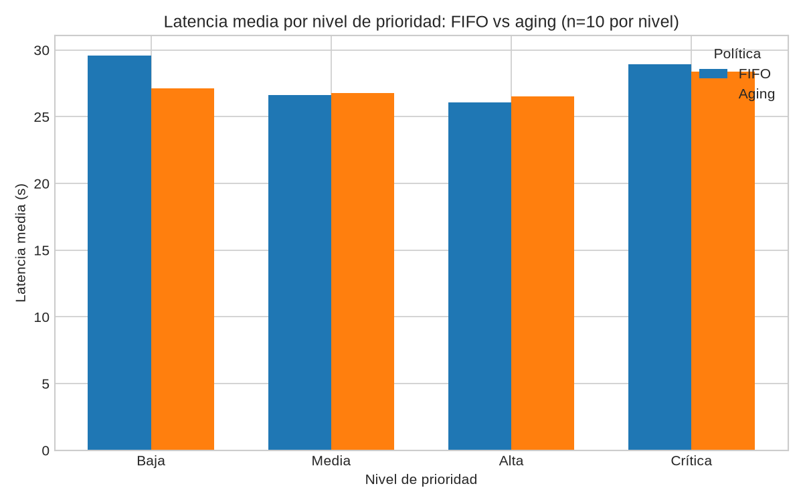{width=5.5in}

**Interpretación.** La diferencia entre FIFO y aging en esta corrida es pequeña (p95 36 s vs 35 s) porque el workload rota las cuatro prioridades uniformemente (25 % cada una) con un solo worker: no hay un flujo sostenido de trabajo de alta prioridad que le dé ventaja real al aging frente a FIFO, así que la propia ficha reconoce que la corrida no establece superioridad de una política sobre la otra. Con `SCHEDULER_AGING_S=2` en vez de 30 el aging satura casi de inmediato (LOW llega a prioridad 4 a los 6 s), lo que sugiere que la ventana de 30 s por defecto es conservadora para este volumen, pero esa sensibilidad no se exploró con un experimento dedicado.

Evidencia B.5 — veredictos: 4 niveles + algoritmo anti-inanición explícito **cumple**; comparación de ≥2 políticas **parcial** (una sola corrida por política, sin repeticiones); flujo sostenido de alta prioridad **falta**; espera/retorno/throughput por prioridad **falta** (los CSV no tienen columna de prioridad); ausencia de inanición con datos **parcial** (se puede derivar el máximo por prioridad pero la ficha no lo presenta).

### 5.3 M3 — E/S y almacenamiento (responsable: David Molina)

**Qué se implementó y dónde.** Partición y reensamblado por chunks con verificación de hash por chunk y global (`chunking/file_chunker.py:13-108`, tamaño por defecto 4 MiB); almacenamiento direccionado por contenido con `os.link` y deduplicación (`content_store/file_store.py:29-71`); cola acotada con política de bloqueo o rechazo (`backpressure/thread_queue.py`); en producción, descarga por chunks de 4 MiB con verificación de hash (`process.py:369-410`), subida directa a S3 con URL prefirmada, y contrapresión real combinando `OUTBOX_QUEUE_LIMIT`, el `max-length` + `reject-publish` de RabbitMQ, y prefetch 1.

**Concepto de sistemas operativos.** E/S por bloques con verificación de integridad, almacenamiento direccionado por contenido, y contrapresión para acotar colas no limitadas. `[FALTA: referencia]`.

**Método de medición.** Throughput variando el tamaño de chunk (256 KiB / 4 MiB / 16 MiB, 3 corridas cada uno) sobre un archivo sintético de 200 MiB en disco local (Windows 11, caché caliente, commit `aae45c9`); deduplicación sobre 10 *puts* sintéticos repetidos; profundidad de cola muestreada (139 filas) bajo política sin límite, con bloqueo y con rechazo, usando una cola de hilos en proceso (no RabbitMQ ni el coordinador real).

**Resultados.** Throughput: 256 KiB → 257.83 ± 3.68 MiB/s; 4 MiB → 215.37 ± 5.87 MiB/s; 16 MiB → 186.34 ± 15.16 MiB/s. Deduplicación sintética: razón 5.0 (175 000 B lógicos / 35 000 B físicos).

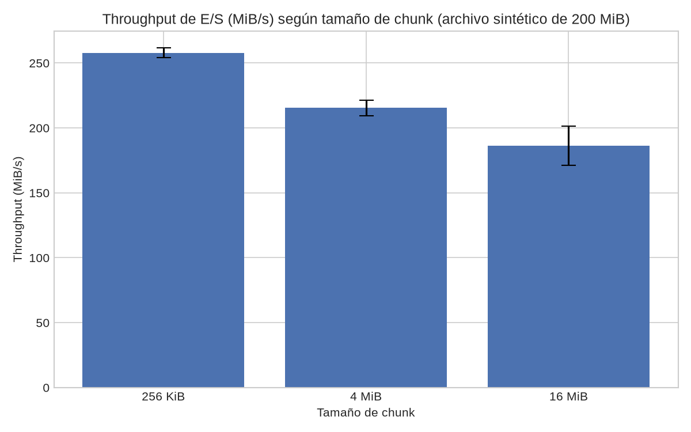{width=5.5in}

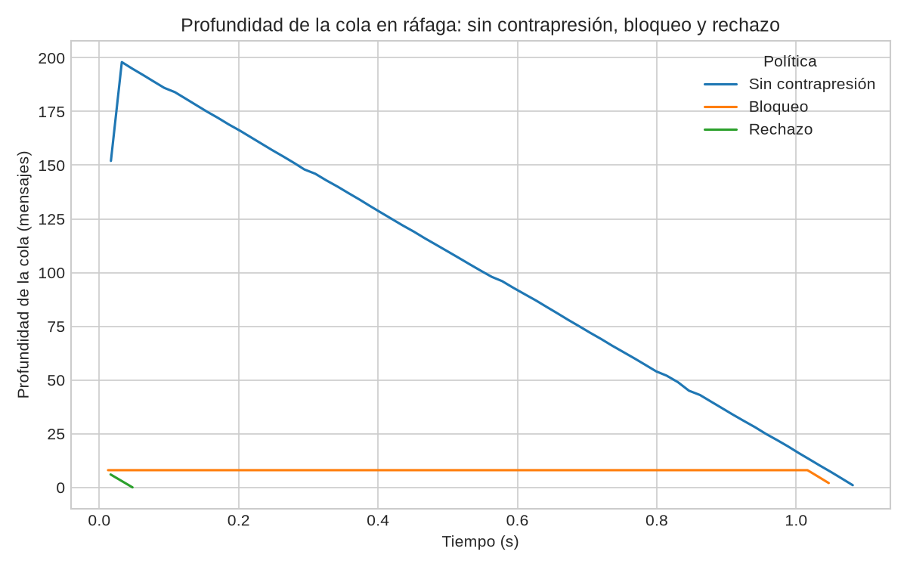{width=5.5in}

**Interpretación.** El chunk más pequeño medido (256 KiB) es el más rápido en esta prueba de disco local, lo contrario de lo que se esperaría si el cuello de botella fuera la sobrecarga por chunk; esto es consistente con que la medición no incluye red ni S3 real, donde chunks más grandes suelen amortizar mejor la latencia por request. El código de producción usa 4 MiB sin que exista una justificación escrita que conecte esa elección con estos datos: la medición respalda la mecánica (partición, hash, contrapresión) pero no el valor concreto del parámetro. La tasa de deduplicación de 5.0 es un resultado sintético declarado explícitamente como "no es evidencia del dataset" por el propio script, así que no permite afirmar nada sobre la redundancia real del dataset de 40 casos.

Evidencia B.5 — veredictos: throughput vs. tamaño de chunk **parcial** (archivo sintético, sin red/S3); tasa de deduplicación sobre el dataset **falta** (solo el valor sintético); profundidad de cola con y sin contrapresión **parcial** (cola de hilos en proceso, no el sistema real); justificación del tamaño de chunk **parcial**; reensamblado verificado por hash **cumple**; CAS SHA-256 **cumple en código**, sin medición en S3; E/S asíncrona o no bloqueante **parcial** (URLs prefirmadas más endpoints síncronos en threadpool, sin comparación).

### 5.4 M4 — Protección y seguridad (responsable en matriz: Fabián Vargas)

**Qué se implementó y dónde.** Autenticación JWT de Cognito (RS256) con tres roles (`analyst`/`supervisor`/`administrator`) verificados en `auth.py:12-60` y `security.py:44-86`, también sobre WebSocket; una tabla `custody` con `hash = sha256(previous || body)` y triggers de PostgreSQL que impiden `UPDATE`/`DELETE`/`TRUNCATE` sobre `cases` y `subtasks` (`db/schema.sql:77-121`), verificada por `scripts/verify_custody.py`; TLS verificado en AMQPS (`shared/broker.py:57-64`) y política S3 que niega tráfico no-TLS; cifrado en reposo con una CMK de KMS con rotación (Terraform) para S3, RDS y secretos; contenedores sin privilegios (uid 10001, `cap_drop ALL`, `no-new-privileges`).

**Concepto de sistemas operativos.** Control de acceso basado en roles, cifrado en tránsito y en reposo, y un registro de auditoría a prueba de manipulación (cadena de hashes solo-anexión). `[FALTA: referencia]`.

**Método de medición.** `verify_custody.py --self-check` sobre una base de datos sintética local; `check_auth.py` offline que asserta los códigos 403/401 esperados por rol; inspección de capacidades efectivas y `no_new_privileges` de los contenedores (`privileges.json`); un chequeo de TLS contra un objetivo local (`tls-target.json`, TLSv1.3).

**Resultados.** Capacidades efectivas de los workers: 0; `no_new_privileges`: 1 (`privileges.json`). Cadena de custodia local: 2976 registros, cabeza `afcbb8a4…57d28` (`custody-head.json`, base sintética local — la cifra de "370 registros" que aparece en la ficha no tiene archivo de respaldo).

**Interpretación.** El módulo cumple en el código las piezas estructurales (RBAC de tres roles, cadena de custodia solo-anexión, TLS en el broker, cifrado en reposo gestionado por KMS, contenedores sin privilegios), pero la evidencia medida es consistentemente **offline o local**: no hay captura de tráfico cifrado entre nodos (ni pcap ni tcpdump, solo un handshake TLS local), no hay salida guardada de las pruebas de denegación por rol (corrieron pero no se persistió su resultado), y la cadena de custodia solo registra mutaciones de filas en PostgreSQL, no hashea los archivos de entrada ni las transformaciones que produce cada worker —el hash SHA-256 de la fuente se verifica aparte, en el worker, al descargar por chunks. El `read_only` del sistema de archivos solo está declarado en el compose del coordinador, no en el de los workers, pese a que `docs/responsabilidades.md` lista `infra/tls/` como evidencia de M4 y ese directorio solo contiene un marcador vacío (el TLS real vive en `modules/tls_origin` y en `serve.py`). No existe una figura para este módulo: ninguno de los artefactos de M4 (JSON sueltos sin script productor) tiene series de datos que se presten a un gráfico.

Evidencia B.5 — veredictos: prueba de manipulación detectada **parcial** (self-check sintético, sin salida guardada de alterar-y-verificar sobre la cadena real); accesos denegados por rol **parcial** (offline, sin salida guardada; `cloud_probe.py` nunca generó `probes.csv`); captura de tráfico cifrado **falta**; workers sin root **cumple**; autenticación + RBAC de 3 roles **cumple en código y prueba offline**, sin campaña de login real en la nube; TLS en tránsito **parcial** (RDS no verifica certificado, TLS del coordinador apagado por defecto); cifrado en reposo y claves **cumple en Terraform**, sin artefacto de evidencia; cadena de custodia **parcial** (filas de BD, no artefactos); FS de solo lectura en workers **falta**.

### 5.5 M5 — Cómputo heterogéneo (responsable: Camila Hidalgo)

**Qué se implementó y dónde.** Banco de pruebas de hilos y cuantización para YOLOv8n y faster-whisper (`experiments/m5_heterogeneous_compute/scripts/{bench,bench_one,plot}.py`); el cambio llevado a producción es `MODEL_THREADS`, que controla los hilos de YOLO (`ops/analysis/image.py:32-38`) y de Whisper (`audio.py:33-35`), fijado en 2 en el despliegue (`remote-node.sh:105`). La política de enrutado del coordinador sigue siendo el mapa estático `OPERATION_POOL` (`shared/routing.py:80-85`): no hay umbral de duración ni selector de dispositivo ni pool de GPU.

**Concepto de sistemas operativos.** Asignación de cómputo heterogéneo (CPU vs. GPU/NPU) y su relación con el ancho de banda de memoria y la cuantización de modelos. `[FALTA: referencia]`.

**Método de medición.** Campaña en un laptop i5-11320H (4 núcleos/8 lógicos, 15.7 GB, solo CPU, Windows 11, 2026-11-11): `runs.csv` (804 filas), `summary.csv` (13 configuraciones), variando hilos (1/2/4/8) y, en Whisper, cuantización (`int8` vs. `float32`) y tamaño de modelo (`tiny` vs. `base`); además una corrida paralela variando procesos × hilos.

**Resultados.** Whisper — p50 / audio-s procesado por s / pico de memoria: `tiny-int8-t2` 1.3447 s / 24.8617 / 322.76 MB; `tiny-float32-t2` 1.8288 s / 17.0087 / 513.36 MB; `base-float32-t4` 3.2739 s / 10.4565 / 679.50 MB. YOLOv8n — p50 (s) / imágenes por s: 1 hilo 0.1043 / 9.449; 2 hilos 0.0814 / 11.5793; 4 hilos 0.0700 / 14.198; 8 hilos 0.0744 / 12.7918 (el máximo de throughput está en 4 hilos, no en 8).

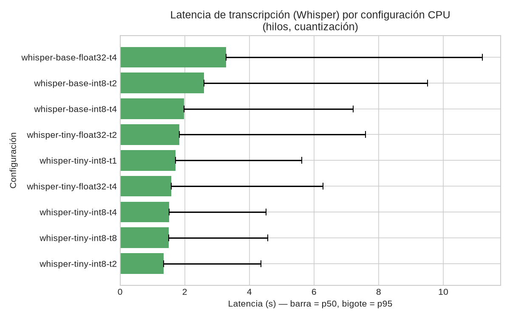{width=5.5in}

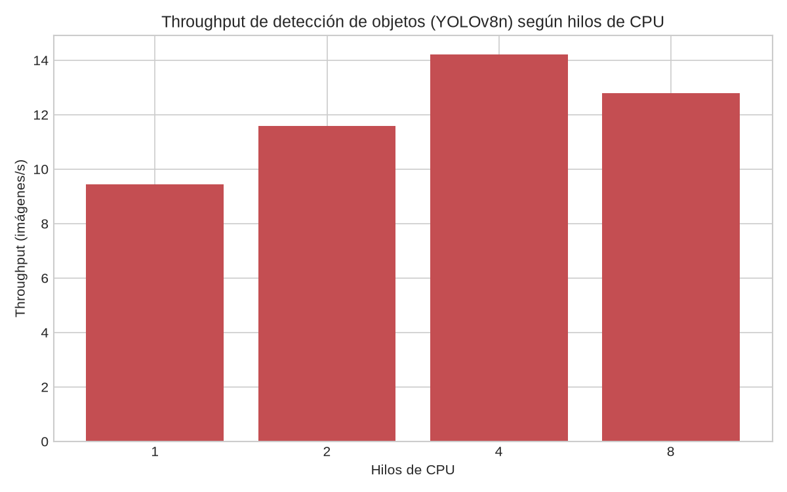{width=5.5in}

**Interpretación.** `tiny-int8` es la configuración de Whisper con mejor throughput y menor memoria pico frente a `base-float32`, lo que justifica la elección de producción (`tiny`, `int8`, 2 hilos) desde el ángulo de cómputo y memoria en esta máquina. Para YOLO, el throughput deja de crecer después de 4 hilos (14.2 frente a 12.8 img/s con 8 hilos) en una CPU de 4 núcleos físicos, consistente con saturación de núcleos reales más sobrecarga de *hyperthreading*; sin embargo, esta campaña corrió en un laptop, no en el t3.large objetivo de despliegue, y no hay ninguna medición con GPU, así que la justificación de "mantener enrutado estático en CPU" que da la ficha de M5 es razonable con los datos disponibles pero no se puede extender a una comparación real CPU/GPU.

Evidencia B.5 — veredictos: ≥2 configuraciones de cómputo **cumple** (hilos y cuantización de CPU; sin GPU, alternativa permitida por el enunciado); tabla de latencia/throughput/memoria **cumple**; justificación de la política de enrutado con datos **parcial** (justifica la configuración del modelo, no una comparación CPU/GPU real); conexión con la Unidad 1 (CPU/GPU/NPU) **cumple en concepto**, sin referencia bibliográfica.

## 6. Pruebas de carga y tolerancia a fallos

Los cinco escenarios de la sección B.6 se ejecutaron con `experiments/fault_tests/run.py` y sus envoltorios, más `services/workers/scripts/local_e2e.py`. **Ninguno de los cinco tiene evidencia en la nube**; ambos README del repositorio lo reconocen explícitamente como una campaña manual pendiente.

| Escenario | Evidencia medida | Entorno | Qué falta |
|---|---|---|---|
| 1. Ráfaga (≥20 casos) | `real-model-cases.csv` (20 filas, todas `completed`; latencia mín. 16.389 s, máx. 131.628 s, mediana 82.897 s, p95 ≈128.1 s); `worker-memory.csv` (483 filas, solo % de memoria) | Docker local en WSL2, modelos CPU reales, manifiestos sintéticos de 3 archivos | Tiempo total y throughput en archivo (solo derivable: 20/131.8 s); CPU y uso por nodo del coordinador/RabbitMQ/PostgreSQL; gráfico de latencia/throughput; evidencia en la nube |
| 2. Caída de worker | `existing-scenarios.csv`, fila `crash,OK` (transcrita de consola) | Local, operaciones simuladas, `kill -9` | Tiempos de detección y reasignación; corrida con workers reales o en AWS; métricas y gráficos |
| 3. Reinicio del coordinador | Misma tabla, fila `restart,OK` | Local, simulado | Tiempos y conteos guardados (el script comprobó 9 sub-tareas sin duplicar, pero solo quedó el veredicto); evidencia en la nube; gráficos |
| 4. Cancelación en curso | `cancellation.csv`, fila `cancel_inflight,OK` | Local, operación simulada de 30 s (`sleep`) | Medición de recursos liberados (memoria, procesos, temporales); latencia de cancelación; un caso pesado real en vez de simulado |
| 5. Saturación de memoria | Solo el barrido de OOM de M1 (`limits.csv`) y chequeos de admisión con SQL simulado | Local | Una corrida donde la carga exceda la memoria del nodo con rechazos de admisión registrados; comparación con la admisión desactivada |

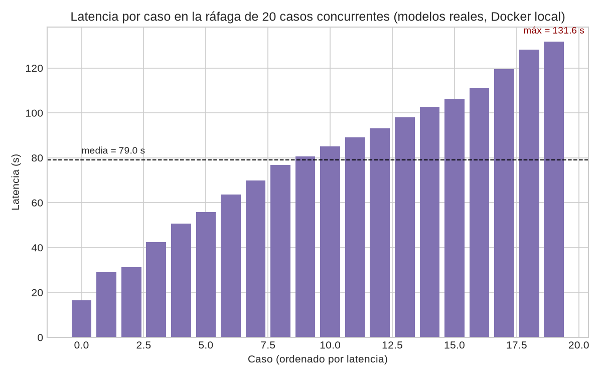{width=5.5in}

Interpretación conjunta: el único escenario con una distribución de latencias medible (escenario 1) muestra una dispersión amplia (16.4 s a 131.6 s) para 20 casos sintéticos de 3 archivos cada uno en un solo nodo Docker local; sin datos de CPU ni de uso del broker/base de datos no es posible atribuir esa dispersión a contención de CPU, a la cola de RabbitMQ o a la base de datos. Los escenarios 2 a 5 solo demuestran que el mecanismo correspondiente (detección de caída, reinicio idempotente, cancelación cooperativa, control de admisión) **se disparó y terminó en el estado esperado**; ninguno cuantifica cuánto tardó ni cuántos recursos liberó, que es justamente la evidencia que pide la sección B.6. Hay además evidencia suelta de la nube que no corresponde a estos cinco escenarios (`docs/handoff-completion.md:47-62`: dos casos reales, 3/3 en 4.0 s y 6/6 en 12.0 s, sin archivo crudo).

## 7. Decisiones técnicas

- **RabbitMQ + PostgreSQL en vez de SQS + DynamoDB.** Motivado directamente por tres necesidades de los módulos de SO: colas acotadas con rechazo al publicador (M3, SQS no tiene longitud máxima), prioridad nativa de mensajes (M2) y transacciones SQL multi-fila para la barrera y el outbox (en vez de `TransactWriteItems`).
- **Outbox transaccional en PostgreSQL.** Corrige una limitación conocida de Proyecto I (entradas de outbox huérfanas si el proceso muere a mitad de escritura): el caso, sus sub-tareas y el registro de outbox se escriben en una sola transacción SQL, y el sweeper repara lo que quedó sin encolar tras un reinicio.
- **Aislamiento de cada operación de análisis en un proceso hijo `spawn`.** Permite matar una operación en curso (cancelación real, a diferencia de Proyecto I que solo cancelaba antes de empezar) y da un límite de memoria por operación vía cgroups, al costo medido en M1 de recargar el modelo en cada invocación.
- **CAS de producción como `put_object(IfNoneMatch="*")` directo sobre `content/<sha256>`**, en vez de usar las clases `FileContentStore`/`ThreadBoundedQueue` del paquete `storage` (que solo se usan en el benchmark de M3 y en `check_storage.py`). Evita depender de `os.link`, que no tiene sentido entre el proceso del worker y un bucket S3.
- **Política de enrutado estática por tipo de operación (M5) en vez de un selector dinámico de dispositivo.** Decisión explícita de la ficha de M5 ante la ausencia de GPU disponible para medir: con los datos de CPU recogidos no hay base para construir un umbral de enrutado dinámico.
- **Cadena de custodia a nivel de filas de PostgreSQL (triggers que bloquean `UPDATE`/`DELETE`/`TRUNCATE`), no a nivel de archivos.** Cubre la manipulación del estado del caso en la base de datos; la integridad del contenido descargado se verifica aparte, por hash SHA-256, en el worker.

## 8. Limitaciones

Limitaciones de evidencia (ninguna se completó con nuevas mediciones para esta entrega, por decisión del equipo de dejar los huecos documentados en vez de improvisar datos):

- `[FALTA]` Ningún escenario de B.6 tiene evidencia en la nube (cinco huecos, uno por escenario).
- `[FALTA]` Escenario B.6-1 (ráfaga): sin tiempo total ni throughput guardados en archivo, sin CPU por nodo, sin uso del coordinador/RabbitMQ/PostgreSQL.
- `[FALTA]` Escenarios B.6-2 y B.6-3: solo un veredicto `OK` transcrito de consola, sin tiempos ni conteos guardados.
- `[FALTA]` Escenario B.6-4: ninguna medición de recursos liberados tras cancelar.
- `[FALTA]` Escenario B.6-5: ninguna corrida donde la admisión rechace trabajo bajo saturación real, ni comparación con la admisión desactivada.
- `[FALTA]` M1: ráfaga de memoria en bytes (solo hay en %) y en la nube; OOM con requeue real del broker; calibración de las bases de admisión contra los perfiles medidos.
- `[FALTA]` M2: flujo sostenido de alta prioridad; espera/retorno/throughput por prioridad; columna de prioridad en los CSV; repeticiones de la corrida; máquina y fecha de la medición; corrida con el workload real del dataset o en la nube.
- `[FALTA]` M3: tasa de deduplicación sobre el dataset real (no el valor sintético); throughput con la media del dataset (≥200 MB) o por red/S3; contrapresión sobre el sistema real (RabbitMQ/coordinador), no una cola de hilos en proceso; justificación escrita del chunk de 4 MiB.
- `[FALTA]` M4: captura de tráfico cifrado entre nodos; salidas guardadas de las pruebas de manipulación y de denegación por rol; `probes.csv` de `cloud_probe.py`; `read_only` en los workers; hash de las transformaciones (no solo del estado en BD); origen de la cifra "370 registros" de la ficha.
- `[FALTA]` M5: ninguna medición con GPU ni en el hardware objetivo (t3.large); verificación de que `MODEL_THREADS` llegó al despliegue en AWS.
- `[FALTA]` Dataset: media (imágenes, audios, videos) no disponible en disco ni publicada, lo que impide verificarla y correr M3 sobre datos reales; máquina de `dataset/generators/evaluate.py` no registrada.
- `[FALTA]` Referencia bibliográfica (autor y capítulo) para cada uno de los cinco conceptos de sistemas operativos: el repositorio no contiene ningún libro, capítulo ni paper citado, solo enlaces a proyectos.
- `[FALTA]` Commit o tag exacto entregado de Proyecto I y retroalimentación del instructor sobre esa entrega (`docs/reutilizacion.md:5,98`).
- `[FALTA]` Nombres completos y carnés confirmados de los tres integrantes, y apellido del profesor (ver portada).

Limitaciones de diseño, no de evidencia:

- La cancelación no interrumpe una descarga de S3 en curso ni purga sub-tareas que siguen en cola (solo se cancelan al ser consumidas por un worker).
- El reporte no tiene una estructura de "incidencias" separada de los hallazgos por sub-tarea.
- El `read_only` del sistema de archivos solo está declarado para el coordinador, no para los workers.
- El dashboard no reporta uso de GPU porque ningún componente del sistema mide ni gestiona GPU.

## 9. Lecciones aprendidas

- Medir antes de fijar un parámetro de producción evita decisiones a ciegas, pero medir en una máquina o entorno distinto del objetivo (el throughput de chunk de M3 en disco local Windows, el banco de M5 en laptop en vez de t3.large) limita cuánto se puede generalizar esa medición al entorno real de despliegue.
- Una base de admisión de memoria "estimada" sin calibrar contra perfiles medidos reales tiene consecuencias funcionales directas y no solo teóricas: rechazó 37 de 40 casos del dataset en la nube hasta que se corrigió a partir de evidencia (ver fila M1 de `docs/bitacora_ia.md` y el capítulo 5.1 de este informe).
- Un error de reloj entre dos componentes que deberían compartir la misma noción de tiempo (el coordinador calculando `retry_at` con su reloj de host mientras el outbox lo comparaba con el reloj de la base de datos) es más fácil de evitar calculando la marca de tiempo en el mismo lugar donde se compara, en este caso dentro de la propia sentencia SQL.
- Confiar en que una librería externa respeta una variable de entorno sin verificarlo en el proceso real cuesta tiempo de depuración: `ultralytics.select_device()` reseteaba los hilos de PyTorch en el primer `predict()`, así que las cuatro configuraciones de "hilos" del banco de M5 corrieron en realidad con el mismo número de hilos hasta que se detectó en una columna de diagnóstico del propio CSV de salida.
- Escribir resultados incrementalmente (no solo al final de una campaña larga) protege contra fallos del entorno de medición: el primer intento de la campaña de M5 perdió 4 de 9 configuraciones de audio por una caída del sistema operativo del laptop, antes de que el script empezara a reescribir sus CSV después de cada configuración.

## 10. Uso de IA

El uso de herramientas de IA está documentado en detalle, incluyendo errores y su corrección, en `docs/bitacora_ia.md`; aquí se resume. Los tres integrantes dejaron registro: David Molina con Codex (5 filas de la tabla principal más una tabla de 4 errores de la fase de cierre y narrativa adicional), Fabián Vargas con Claude Code (14 filas) y Camila Hidalgo con Claude Code / Claude Opus 5.5 (13 filas). En total hay más de los dos errores de IA exigidos por el enunciado documentados con causa y corrección; ninguna fila está etiquetada específicamente para M2 ni para M4 (M2 solo se menciona de paso en la bitácora).

Errores de IA documentados que afectaron código de producción o datos de este informe (selección, no la lista completa):

- **Permisos de ECR incompletos en el pipeline de CI/CD**: faltaba `ecr:BatchGetImage`, lo que hacía fallar `docker push` con 403 porque `docker` revisa el manifiesto remoto antes de subir la imagen. Corregido agregando la acción, aún limitada a los cuatro repositorios de imágenes.
- **Admisión de memoria cobrando la base del modelo por sub-tarea en vez de por operación distinta**: causó que 37 de 40 casos del dataset recibieran un 413 permanente bajo el presupuesto de memoria desplegado. Corregido cobrando la base una sola vez por operación distinta y el tamaño de entrada por sub-tarea; verificado con un caso real que pasó de rechazado a 6/6 sub-tareas completadas en 12 s en la nube.
- **Control de hilos de YOLO ignorado por la librería**: `ultralytics.select_device()` reinicializaba los hilos de PyTorch al valor por defecto de la máquina en la primera predicción, anulando silenciosamente el parámetro `MODEL_THREADS` que el benchmark de M5 creía estar variando. Detectado por una columna de diagnóstico (`torch_threads`) que mostraba el mismo valor en las cuatro configuraciones nominalmente distintas.
- **Primera versión de la detección de caída de worker intolerante a una caída real de PostgreSQL**: el sweeper quedaba bloqueado esperando una conexión del pool (30 s) y, al volver la base de datos, corría una sola pasada y marcaba muertos a todos los workers cuyo heartbeat no había podido escribirse durante el corte. Corregido con una espera de pool de 5 s y un período de gracia de dos intervalos de heartbeat tras una pasada fallida; verificado con un escenario nuevo (`dbdown`) que detiene PostgreSQL 20 s con un caso en curso.

## Referencias

Solo se listan las referencias que ya existen en el repositorio. El enunciado pide indicar en qué capítulo de la bibliografía se sustenta cada concepto de sistemas operativos; el repositorio no contiene ningún libro, capítulo ni paper citado para M1–M5, por lo que esa referencia se marca `[FALTA: referencia]` en cada subsección del capítulo 5.

- Proyecto I del equipo: [FabiSax12/distributed-multimedia-processing](https://github.com/FabiSax12/distributed-multimedia-processing), commit `de2c96c` (`docs/reutilizacion.md:5`; commit exacto de la entrega sin confirmar, `[FALTA]`).
- COCO 2017 (imágenes del dataset): <https://cocodataset.org> (licencias CC BY 2.0, CC BY-SA 2.0, CC BY-ND 2.0; anotaciones CC BY 4.0) (`docs/dataset.md:285`).
- Ultralytics, documentación de predicción (YOLOv8n): <https://docs.ultralytics.com/modes/predict/> (`services/workers/README.md:217`).
- faster-whisper: <https://github.com/SYSTRAN/faster-whisper> (`services/workers/README.md:218`).
- `[FALTA: referencia]` — gestión de memoria y control de admisión (M1).
- `[FALTA: referencia]` — planificación por prioridades y aging (M2).
- `[FALTA: referencia]` — E/S por bloques, almacenamiento direccionado por contenido y contrapresión (M3).
- `[FALTA: referencia]` — control de acceso, cifrado y registros de auditoría a prueba de manipulación (M4).
- `[FALTA: referencia]` — cómputo heterogéneo CPU/GPU/NPU (M5).
