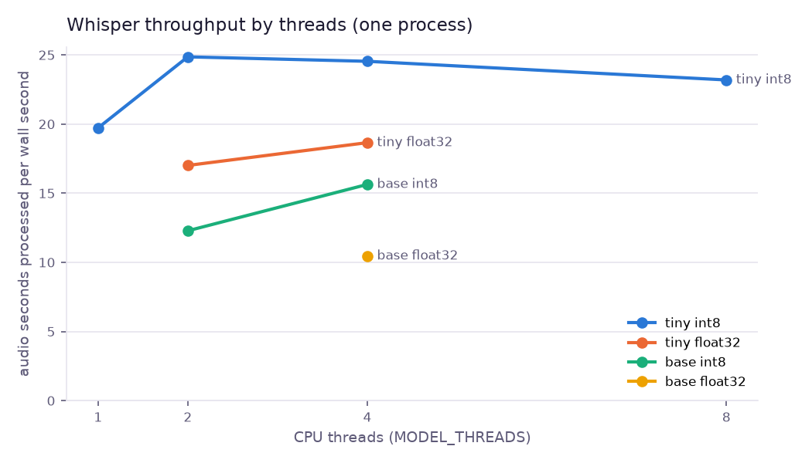
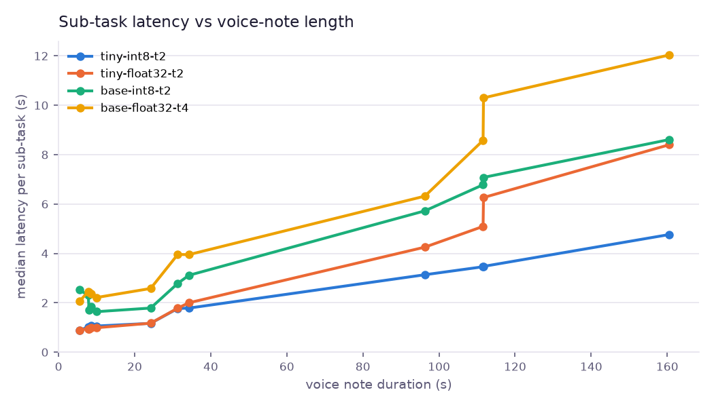
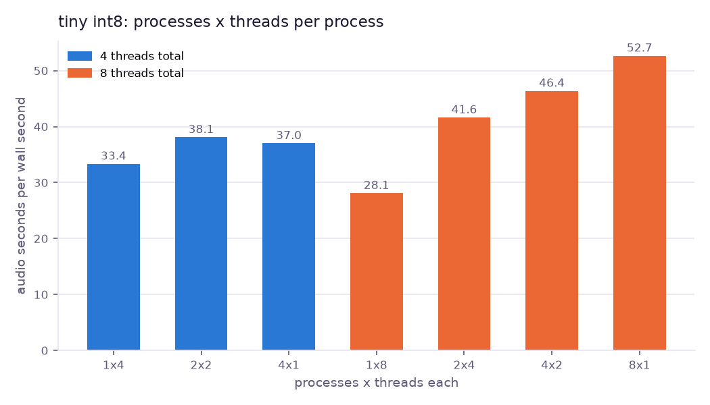
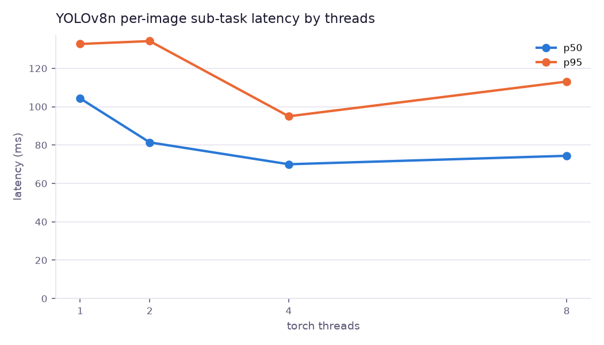

# Module: Heterogeneous compute    Owner: Camila Hidalgo

## 1. What was implemented

- `experiments/m5_heterogeneous_compute/scripts/bench.py` + `bench_one.py`: a
  benchmark of the two heavy analysis models of the platform, faster-whisper
  (audio pool) and YOLOv8n (image pool), under controlled CPU configurations.
  It runs the **production operations** (`workers.ops.run_local.run`: ffmpeg
  extraction, hashing, model, findings) on inputs taken from the project
  dataset, one configuration per process, as a worker slot would.
- Configurations (GPU route not available on this host, so the handoff's
  alternative: threads and quantization on CPU):
  - Whisper `tiny` and `base` x compute type `int8` (CTranslate2 8-bit weight
    quantization) and `float32` x `MODEL_THREADS` 1/2/4/8 (9 configurations);
  - YOLOv8n float32 x torch threads 1/2/4/8;
  - Whisper tiny/int8 with P processes x T threads on a fixed budget of 4 and
    8 hardware threads (1x4, 2x2, 4x1, 1x8, 2x4, 4x2, 8x1): the question a
    worker pool actually faces (more slots or more threads per slot).
- Transcription quality per configuration: word error rate against the exact
  script the dataset generator synthesized, so quantization is judged on
  accuracy as well as speed.
- `plot.py`: figures and tables below. Raw CSVs (one row per run) and
  `host.json` (hardware, OS, library versions, memory scope) are in
  `experiments/m5_heterogeneous_compute/results/laptop-i5-11320h/`.
- Finding about the image worker: `MODEL_THREADS`/`OMP_NUM_THREADS` never
  reach YOLO. Ultralytics' `select_device()` runs on the first `predict` and
  calls `torch.set_num_threads(min(8, cpu_count - 1))`. The benchmark pins
  ultralytics' `NUM_THREADS` to control the variable; production uses the
  ultralytics default (see section 5 and the routing decision).

## 2. Operating systems concept

Heterogeneous compute is the scheduling of work onto processing units with
different strengths: CPU cores (few, fast, general, large caches), GPUs (many
simple lanes, high memory bandwidth, separate memory reached over PCIe) and
NPUs (fixed-function low-precision matrix units). The OS-level questions are:

- **Parallelism inside one process vs across processes.** A model can split
  one inference across threads (intra-op parallelism, shared memory, needs
  synchronization per layer) or the scheduler can run several independent
  inferences in separate processes (no synchronization, but each process
  pays its own model memory). The kernel schedules both kinds of threads on
  the same cores; logical CPUs from hyper-threading share execution units.
- **Memory bandwidth and footprint.** Transformer decoding (Whisper) is
  dominated by reading weights for every generated token; smaller weights
  (int8 = 1 byte vs float32 = 4 bytes) mean fewer bytes moved per token and a
  smaller resident set, which is also what admission control (M1) budgets.
- **Transfer cost to an accelerator.** A GPU needs inputs and weights copied
  over PCIe and a kernel launch per operation; for a 5-second voice note or a
  single 640x480 image the fixed cost can exceed the compute it saves.
- **Quantization** trades numeric precision for bandwidth and arithmetic
  throughput; NPUs are built around exactly this (int8/int4 MACs).

## 3. Measurement method

- **Host**: laptop, Intel Core i5-11320H (4 cores / 8 hardware threads,
  Tiger Lake, AVX-512/VNNI), 15.7 GB RAM, Windows 11. Exact
  versions in `host.json`. No other heavy workload ran during the campaign
  (only editing and git in other terminals).
- **Inputs** (seed 42, from the generated dataset): 12 voice notes
  stratified by duration, 4 short (5.5-8.6 s), 4 medium (10.0-34.2 s), 4 long
  (96.3-160.5 s), 610 s of audio in total; 40 images (COCO JPEGs, 640 px).
- **Procedure per configuration**: new process with the configuration in its
  environment (`AUDIO_MODEL`, `AUDIO_COMPUTE_TYPE`, `MODEL_THREADS`,
  `OMP_NUM_THREADS`); time imports, then the worker's `load_model()` (cold
  load from the local disk cache; weights were downloaded beforehand so no
  network time is included), then one warm-up run (discarded), then
  3 repeats over every input. Latency is the wall time of the production
  operation for one input (decode + resample with ffmpeg, SHA-256, model,
  rules): what a worker slot spends per sub-task, **without** broker and S3
  transfer (measured separately in M3).
- **Metrics**: p50/p95 latency over all warm runs (36 per audio
  configuration, 120 per image configuration) and per duration bucket;
  throughput = audio seconds / wall seconds (audio) or images / second;
  memory = process peak working set (Windows `peak_wset`, interpreter +
  libraries + model + buffers; the ffmpeg child process is excluded; no GPU
  memory because no GPU was used); model memory = RSS after `load_model()`
  minus RSS before; WER on the first repeat.
- **Parallel suite**: the 8 medium/long notes (580 s of audio) split
  round-robin over P processes started together, one pass, no warm-up;
  throughput uses the steady makespan (first inference start to last end),
  so model loading is reported separately.

- **Campaign record**: 2026-11-11, 804 warm runs. The host rebooted twice
  during the campaign with Windows bugchecks (`0x1A`, `0x13A`; the same
  machine logged about 16 bugchecks with varying codes since 2026-10-13, so
  this is a pre-existing hardware/driver instability, not caused by the
  benchmark). Results are written per configuration, so an interrupted
  configuration was discarded and rerun from scratch in a new process
  (`--resume`); no configuration mixes runs from two sessions.

## 4. Results

Raw data: `experiments/m5_heterogeneous_compute/results/laptop-i5-11320h/`
(`runs.csv`, `processes.csv`, `summary.csv`, `parallel.csv`, `raw/`).

### Whisper (audio pool), one process

| Configuration | p50 (s) | p95 (s) | p50 short / medium / long (s) | Audio s per s | WER | Load (s) | Model RSS (MB) | Peak RSS (MB) |
|---|---|---|---|---|---|---|---|---|
| tiny int8, 1 thread | 1.71 | 5.61 | 1.21 / 1.71 / 4.23 | 19.7 | 0.009 | 2.25 | 129 | 318 |
| **tiny int8, 2 threads (production)** | **1.34** | **4.36** | 1.01 / 1.33 / 3.47 | **24.9** | 0.009 | 1.84 | 129 | 323 |
| tiny int8, 4 threads | 1.52 | 4.52 | 0.91 / 1.52 / 3.65 | 24.5 | 0.009 | 1.68 | 129 | 328 |
| tiny int8, 8 threads | 1.50 | 4.56 | 1.08 / 1.50 / 3.87 | 23.2 | 0.009 | 2.24 | 130 | 329 |
| tiny float32, 2 threads | 1.83 | 7.59 | 0.95 / 1.80 / 5.58 | 17.0 | 0.009 | 1.83 | 318 | 513 |
| tiny float32, 4 threads | 1.59 | 6.28 | 1.21 / 1.59 / 5.22 | 18.7 | 0.009 | 4.08 | 318 | 522 |
| base int8, 2 threads | 2.59 | 9.51 | 1.84 / 2.16 / 6.82 | 12.3 | 0.005 | 2.12 | 173 | 371 |
| base int8, 4 threads | 1.97 | 7.21 | 1.58 / 1.97 / 6.09 | 15.6 | 0.005 | 2.10 | 177 | 376 |
| base float32, 4 threads | 3.27 | 11.21 | 2.39 / 3.27 / 9.41 | 10.5 | 0.005 | 1.94 | 476 | 680 |

36 warm runs per row (12 notes x 3 repeats). Short = 4 notes of 5.5-8.6 s,
medium = 4 of 10.0-34.2 s, long = 4 of 96.3-160.5 s. "Audio s per s" = total
audio duration / total wall time of the runs (higher is better). Model RSS =
resident memory added by `load_model()`. Repeat-to-repeat variation of the
production configuration: coefficient of variation 2-19% per input (median 10%).

Where the time goes (medians, production configuration): ffmpeg decode and
resample 0.12 s (short) to 0.29 s (long); model 0.89 s for a 5-8 s note and
3.18 s for 96-160 s of audio. The model's real-time factor drops from 0.11
(short) to 0.028 (long): a short note pays a fixed cost because Whisper
always encodes a padded 30-second window.

(The step at about 112 s comes from two notes of almost equal length with
different content and segment counts; decoding time depends on the number of
generated tokens, not only on duration.)

### Process x thread split (tiny int8, 8 medium/long notes, 580 s of audio)

| Processes x threads | Total threads | Steady makespan (s) | Audio s per s | Sum of peak RSS (MB) |
|---|---|---|---|---|
| 1 x 4 | 4 | 17.39 | 33.4 | 327 |
| 2 x 2 | 4 | 15.22 | 38.1 | 599 |
| 4 x 1 | 4 | 15.66 | 37.0 | 1,130 |
| 1 x 8 | 8 | 20.63 | 28.1 | 326 |
| 2 x 4 | 8 | 13.93 | 41.6 | 611 |
| 4 x 2 | 8 | 12.50 | 46.4 | 1,138 |
| 8 x 1 | 8 | 11.01 | 52.7 | 2,110 |

(Higher absolute throughput than the single-process table because this set
has no short notes, whose fixed 30-second-window cost lowers audio-s/s.)

### YOLOv8n (image pool), 40 images x 3 repeats

| Torch threads | p50 (ms) | p95 (ms) | Images per s | Load (s) | Peak RSS (MB) |
|---|---|---|---|---|---|
| 1 | 104 | 133 | 9.4 | 3.01 | 451 |
| 2 | 81 | 134 | 11.6 | 0.62 | 466 |
| 4 | 70 | 95 | 14.2 | 0.57 | 466 |
| 8 | 74 | 113 | 12.8 | 0.54 | 466 |

The 1-thread load time includes the first cold import from disk (later
processes hit the OS file cache). Without the fix below, production would run
with ultralytics' default `min(8, cpu_count - 1)` threads: 7 on this host, 1
on a 2-vCPU t3.large.

### Cost of the compared node types

On-demand Linux prices in us-east-1, checked 2026-11-11 (third-party price
trackers of the AWS list price: Holori/Cloudcheck for g4dn.xlarge, Spendark
for t3.large, the latter last checked July 2026; consistent with the team's
estimate in `infra/terraform/README.md`, about 380 USD/month for g4dn.xlarge):

| Node | vCPU / memory / accelerator | USD per hour | USD per month (730 h) |
|---|---|---|---|
| t3.large (current text/image/audio workers) | 2 vCPU (burstable, 30% baseline per vCPU) / 8 GiB / none | 0.0832 | 60.7 |
| g4dn.xlarge (Terraform GPU switch for audio) | 4 vCPU / 16 GiB / 1 NVIDIA T4 (16 GB) | 0.526 | 384 |

## 5. Interpretation

**Routing decision: keep the static operation -> pool routing on CPU
(`shared/routing.py` unchanged); no GPU pool, no audio-duration threshold.**
Audio stays on `faster-whisper tiny` with `int8` and `MODEL_THREADS=2`, the
current production setting, now backed by measurements; the image pool gets
the same 2 threads (fix below). Capacity is added with more worker processes
or nodes, not more threads per process. The justification:

1. **The CPU already runs far faster than real time.** The production
   configuration processes 24.9 seconds of audio per second on two threads
   (RTF 0.028 on long notes). The whole dataset (74 min of voice notes + 15.5
   min of video audio) is about 3.6 minutes of model time on one such
   process. A 160 s voice note finishes in 4.8 s, so a GPU could save at most
   about 4.5 s on the longest note while still paying the decode, hash and
   queue costs.
2. **The GPU does not pay for itself at this load.** A g4dn.xlarge costs 6.3x
   a t3.large. To match cost per audio hour it must process at least 6.3x
   more audio per hour than the CPU node it replaces, and it must stay busy.
   This project's load arrives in bursts of a few cases, so the GPU would be
   idle most of the time while billed. Short notes are the common case (74
   of 150 are under 10 s) and are dominated by the fixed 30-second window
   and per-file overhead (ffmpeg 0.1-0.3 s, SHA-256, model call), which a GPU
   does not remove; the PCIe copy and kernel launches add their own fixed
   cost.
3. **Crossover, as a condition, not a measurement.** No GPU was available,
   so no crossover point was measured and none is claimed. Our numbers say
   when a GPU becomes worth evaluating: a sustained audio backlog above what
   CPU audio slots clear (about 25 audio-seconds per second per 2-thread slot
   on this laptop), or a larger model. `base` already costs 1.3-2x the
   latency of `tiny` on CPU, and `small`/`medium` would grow further. On this
   synthetic speech, `tiny` reaches WER 0.009 and `base` 0.005, so a larger
   model is not justified either. Real, noisy voice notes may change that.
   If it does, the next step is to build a CUDA worker image (the repo pins
   CPU PyTorch, and `MODEL_DEVICE=cuda` alone installs nothing), measure on a
   g4dn.xlarge, and only then add a GPU queue.

**Quantization (int8 vs float32).** For `tiny`, int8 beats float32 on every
axis: 1.4-1.6x faster on long notes (3.47 s vs 5.58 s at 2 threads, 3.65 s vs 5.22 s at 4), 2.5x
less model memory (129 vs 318 MB), and the same WER (0.009). For `base`,
int8 is 1.5-1.7x faster than float32 with 2.7x less model memory. Decoding
a transformer reads every weight for every generated token, so it is
memory-bandwidth bound. 8-bit weights move a quarter of the bytes per token
and fit better in the caches, and this CPU's AVX-512 VNNI instructions do
int8 dot products natively. NPUs are built around the same idea:
low-precision multiply-accumulate units fed by a small memory footprint. So
an NPU would favor the int8 model we already chose, while a GPU's advantage
is wide float16 parallelism that a model this small cannot fill.

**Threads vs processes (parallelism).** Within one process, throughput peaks
at 2 threads (24.9) and falls slightly at 4 and 8. Whisper decodes tokens
one after another, and each token's matrix products are small, so splitting
them across more threads adds synchronization (barriers per layer) faster
than it adds useful work. At 8 threads the process also lands on
hyper-threads, which share each core's execution units. Across processes
there is nothing to synchronize: voice notes are independent. 8 processes x
1 thread reach 52.7 audio-s/s, 1.9x the 28.1 of 1 process x 8 threads on the
same cores. The cost is memory: every process loads its own model, so total
peak memory grows from 0.33 GB to 2.1 GB. That is the M1 trade-off
(per-process models vs sharing, admission by memory budget). For the pool
this means:

- **Slot sizing**: prefer more worker processes (slots) with 1-2 threads
  each over one slot with many threads, while the memory budget allows it.
  On a 2-vCPU t3.large with an 8 GiB node and a 1 GiB worker limit, the
  measured knee supports the current `WORKER_CONCURRENCY=1`,
  `MODEL_THREADS=2`. Raising slots per node is a proposal that would need
  its own measurement on the t3.large, which has one physical core behind
  its 2 vCPUs and a 30% CPU-credit baseline.
- **Image pool**: YOLOv8n is a convolutional network whose large matrix
  operations parallelize well: 1 -> 4 threads cuts p50 from 104 to 70 ms
  (1.5x). It degrades at 8, where hyper-threads contend for the same
  execution units.

**Implemented change from the measurement.** `image.py` ignored
`MODEL_THREADS`: ultralytics resets torch to `min(8, cpu_count - 1)`
threads on the first `predict`, which means 1 thread on the 2-vCPU
t3.large. The image op now sets ultralytics' thread constant from
`MODEL_THREADS` (verified with `run_local`: torch keeps 2 threads after
`predict`). Deployed nodes already pass `MODEL_THREADS=2`; this was not yet
rolled out to AWS, so the cloud effect is unverified.

**Limits of this evidence.** One laptop CPU (4 cores at up to 4.5 GHz, not
a burstable 2-vCPU EC2 instance), Windows, synthetic TTS speech (clean,
which flatters WER), and process memory measured as Windows peak working
set. The relative results (int8 > float32, a knee at 2 threads,
processes > threads) are the transferable part, not the absolute seconds.
